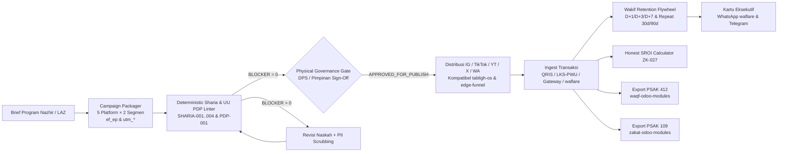

# 🕌 nazhir-reach

> **Sharia-Compliant Campaign Distribution, Wakif Retention Flywheel & PSAK 412/109 Impact Attribution Suite**  
> Dirancang untuk **Nazhir Wakaf** dan **Lembaga Amil Zakat (LAZ)** di Indonesia — mendukung ekosistem **Amal Produktif**, **Asosiasi Nazhir Indonesia (ANI)**, **Forum Wakaf Produktif (FWP)**, serta terhubung langsung dengan [`waqf-odoo-modules`](https://github.com/ridloabelian/waqf-odoo-modules) dan [`zakat-odoo-modules`](https://github.com/ridloabelian/zakat-odoo-modules).

[](https://nodejs.org)
[](https://www.typescriptlang.org/)
[](https://hono.dev)
[](https://web.iaiglobal.or.id)
[-0C172E)](#-1-filosofi--landasan-regulasi)
[](LICENSE)

---

## Mengapa `nazhir-reach` Dibangun?

Banyak lembaga wakaf dan zakat aktif memproduksi konten edukasi di Instagram, TikTok, YouTube Shorts, X/Threads, dan WhatsApp Broadcast, namun menghadapi tiga celah kritis:
1. **Risiko Kepatuhan Syariah & Regulasi di Naskah Kampanye**: Copywriting media sosial kerap keliru menjanjikan imbal hasil pribadi untuk Wakif, mencampur terminologi Wakaf dan Zakat, lupa mencantumkan nomor **STBPN BWI / LKS-PWU / SK LAZ**, atau membocorkan NIK/nomor pribadi penerima manfaat (*UU No. 27/2022 PDP*).
2. **Buta Atribusi & Retensi Wakif (*Flywheel Gap*)**: Tim tidak mengetahui konten edukasi (`ef_ep`) mana yang benar-benar melahirkan **Wakif Baru**, seberapa tinggi **Repeat Wakif Rate (30/90 hari)** setelah menerima laporan dampak, serta berapa rasio biaya distribusi terhadap total dana terhimpun.
3. **Pencampuran Akad & Klaim Dampak Berlebihan (*Vanity SROI*)**: Dana Wakaf Abadi dan ZIS harus dipisahkan secara ketat untuk pembukuan **PSAK 412** dan **PSAK 109** di Odoo ERP, sedangkan laporan SROI kepada Wakif harus jujur setelah dikurangi *deadweight, displacement, attribution,* dan *drop-off*.

Mengadaptasi pola kerja orkestrasi distribusi kreator dari [`CzzzzzzJ/mdldm-maitian`](https://github.com/CzzzzzzJ/mdldm-maitian) ke domain **Filantropi Islam & Wakaf Produktif**, `nazhir-reach` menghadirkan meja kerja end-to-end dengan proteksi kepatuhan deterministik.

---

## 🧭 1. Filosofi & Landasan Regulasi

1. **Prinsip `La Yufti` & Neuro-Symbolic Pre-Screening (`ZK-023`)**  
   AI **bukan Mufti** dan tidak mengeluarkan fatwa. `nazhir-reach` memakai **Deterministic Sharia, Regulatory & UU PDP Copy Linter** berbasis aturan eksplisit:
   - **UU No. 41 Tahun 2004 tentang Wakaf** (Pasal 12: hak imbal jasa Nazhir maks. 10% dari hasil bersih; Pasal 28 & 40: LKS-PWU & perlindungan pokok wakaf) & **PP No. 42/2006**.
   - **UU No. 23 Tahun 2011 tentang Pengelolaan Zakat** (8 Asnaf, SK Izin LAZ, hak Amil maks. 1/8 atau 12,5%).
   - **Fatwa DSN-MUI Wakaf Uang / CWLS** & standar **SKKNI LSP BWI**.
   - **UU No. 27 Tahun 2022 tentang Pelindungan Data Pribadi (UU PDP)**.
2. **Digital Philanthropy Flywheel & Wakif LTV (`ZK-004`)**  
   Membedakan distribusi konten untuk segmen **Calon Wakif Baru** dan **Laporan Dampak Wakif Eksisting**, lalu melacak kohort `D+1 / D+3 / D+7` serta *Repeat Wakif Rate 30/90 hari*.
3. **3-Layer Islamic Blended Finance & Honest SROI (`ZK-026` & `ZK-027`)**  
   - **Layer 1 (`PSAK 109`)**: Zakat Maal, Infak Terikat (*Muqayyad*), dan Dana Sosial Dampak untuk *social de-risking*.
   - **Layer 2 (`PSAK 412`)**: Wakaf Uang Abadi, Wakaf Melalui Uang, dan CWLS Ritel (*Hifz al-Ashl* — pokok kekal abadi terproteksi).
   - **Honest SROI**: Menghitung *Present Value* manfaat bersih setelah diskon *Deadweight*, *Displacement*, *Attribution*, dan *Drop-Off*.

---

## 🏗️ 2. Arsitektur Sistem



---

## 🚀 3. Menjalankan Mode Demo Cepat (`:8793`)

Prasyarat: **Node.js ≥ 22.5** (memanfaatkan built-in `node:sqlite`).

```bash
git clone https://github.com/ridloabelian/nazhir-reach.git
cd nazhir-reach
npm install
npm run demo
```

Buka **`http://localhost:8793`** di browser untuk mencoba:
1. **Wakif Flywheel & PSAK 412/109 Dashboard** — KPI terhimpun, *Repeat Wakif Rate 30d/90d*, tabel kohort `D+1/D+3/D+7`, rasio biaya distribusi, serta saldo terpisah PSAK 412 vs PSAK 109 dengan varians `Rp 0`.
2. **Sharia & UU PDP Copy Linter Playground** — Pengujian langsung aturan `SHARIA-001` s/d `SHARIA-004` dan `PDP-001` lengkap dengan output *scrubbing* PII.
3. **Campaign Packager & DPS Gate** — Membuat paket 10 varian konten dari 1 brief dan menguji blokade *Physical Governance Gate*.
4. **Honest SROI Estimator (`ZK-027`)** — Simulasi perbandingan *Vanity Ratio* vs *Deadweight-Discounted SROI*.

---

## ⚖️ 4. Matriks Aturan Linter Deterministik

| Kode Aturan | Fokus Pemeriksaan | Keparahan | Rujukan Regulasi |
| :--- | :--- | :--- | :--- |
| `SHARIA-001` | Janji imbal hasil/cuan/bunga/cashback pribadi untuk Wakif, pencairan pokok wakaf, atau spekulasi berisiko kehilangan pokok | `BLOCKER` | UU 41/2004 Ps. 40 & 42, Fatwa DSN-MUI Wakaf Uang, *Hifz al-Ashl* (`ZK-026`) |
| `SHARIA-002` | Pencampuran akad Wakaf vs Zakat, pemotongan operasional dari pokok wakaf, ujrah Nazhir > 10%, hak Amil Zakat > 12,5% | `BLOCKER` | UU 41/2004 Ps. 12, UU 23/2011, PSAK 412 vs PSAK 109 |
| `SHARIA-003` | Ketiadaan nomor STBPN BWI & nama LKS-PWU (untuk Wakaf Uang/CWLS) atau SK Izin LAZ (untuk Zakat) | `BLOCKER` / `WARNING` | UU 41/2004, PP 42/2006, PerBWI, UU 23/2011 Ps. 18 |
| `SHARIA-004` | Framing merendahkan martabat Mauquf 'Alaih / Mustahik atau ancaman spiritual manipulatif | `BLOCKER` / `WARNING` | Maqasid al-Shariah (*Hifz al-'Irdh*), SKKNI LSP BWI |
| `PDP-001` | Kebocoran NIK/No. KK 16 digit, rekening pribadi penerima manfaat, atau nomor HP pribadi tanpa label hotline resmi | `BLOCKER` | UU No. 27 Tahun 2022 tentang Pelindungan Data Pribadi |

---

## 🔌 5. Integrasi Ekosistem (`tabligh-os`, `edge-funnel`, `waqf-odoo-modules`, `zakat-odoo-modules`)

- **Parameter Atribusi Kampanye**: Seluruh tautan kampanye otomatis menyematkan `ef_ep`, `utm_source`, `utm_medium`, `utm_campaign`, `utm_content`, dan `akad` sehingga kompatibel penuh dengan pelacakan distribusi konten di **`tabligh-os`** dan konversi halaman di **`edge-funnel`**.
- **Bridge Akuntansi Odoo ERP**:
  - `GET /api/export/odoo/json` — Memisahkan jurnal ke payload `psak412_waqf` (siap diimpor ke `ridloabelian/waqf-odoo-modules`) dan `psak109_zis` (siap diimpor ke `ridloabelian/zakat-odoo-modules` termasuk penanda `BSZ` Zakat).
  - `GET /api/export/odoo/csv?standard=psak412` & `?standard=psak109` — Ekspor CSV berstandar RFC 4180.
- **Notifikasi Pengurus**: `POST /api/notifications/digest` menghasilkan kartu ringkasan harian untuk WhatsApp (`waflare`) dan Telegram.
- **AI Agent Skill**: Tersedia di [`skills/nazhir-campaign/SKILL.md`](skills/nazhir-campaign/SKILL.md) serta CLI `npm run lint:copy`.

---

## 🧪 6. Pengujian & Pengembangan

```bash
npm run typecheck   # Validasi TypeScript strict mode
npm test            # Menjalankan seluruh unit & integration tests (Vitest)
npm run build       # Kompilasi produksi ke dist/
npm start           # Menjalankan server produksi pada port 8793
```

---

## 📄 Lisensi

Proyek ini dirilis dengan lisensi [MIT](LICENSE) untuk kemajuan ekosistem tata kelola Nazhir Wakaf dan Lembaga Amil Zakat Indonesia.
